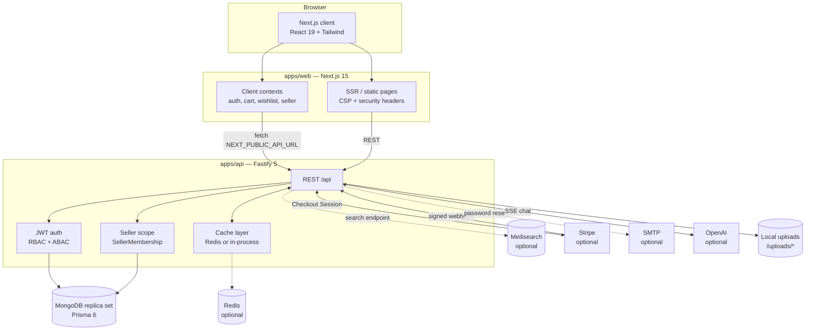
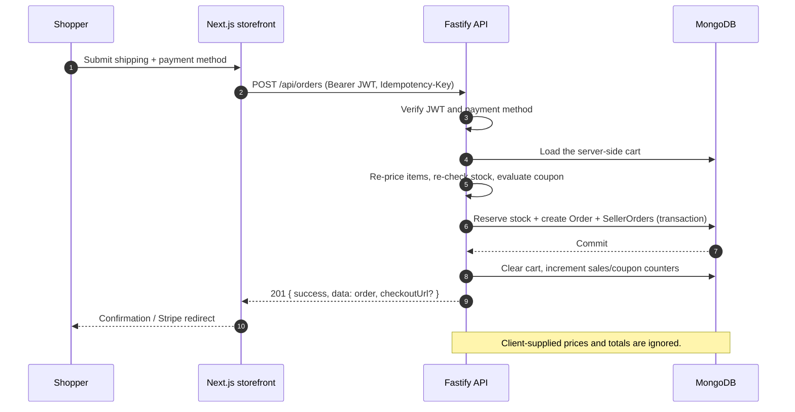
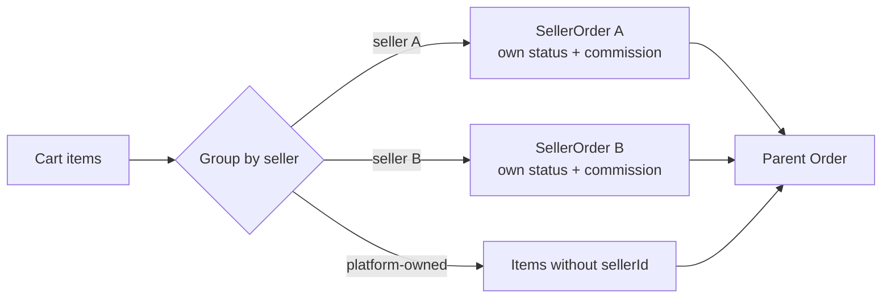

<h1 align="center">Ponnaloy</h1>

<p align="center">
  <strong>A production-minded, multi-vendor e-commerce platform built as a pnpm monorepo.</strong><br/>
  Next.js 15 storefront · Fastify 5 API · Prisma + MongoDB · server-enforced seller and admin portals
</p>

<p align="center">
  <a href="https://nextjs.org"></a>
  <a href="https://react.dev"></a>
  <a href="https://fastify.dev"></a>
  <a href="https://www.prisma.io"></a>
  <a href="https://www.mongodb.com"></a>
  <a href="https://www.typescriptlang.org"></a>
  <a href="https://pnpm.io"></a>
  <a href="#license"></a>
</p>

<p align="center">
  
  
  
  
</p>

<p align="center">
  <a href="#overview">Overview</a> ·
  <a href="#features">Features</a> ·
  <a href="#tech-stack">Tech Stack</a> ·
  <a href="#architecture">Architecture</a> ·
  <a href="#getting-started">Getting Started</a> ·
  <a href="#api-reference">API</a> ·
  <a href="#deployment">Deployment</a> ·
  <a href="#roadmap">Roadmap</a>
</p>

---

> [!IMPORTANT]
> **Project status — active development.** The application runs locally and against a
> production MongoDB Atlas cluster. Type checking, linting, 54 API tests, 20
> Playwright/axe tests and the production build pass. Live card capture, external
> email delivery, CI, and a public deployment are **not** verified. See
> [Project Status](#project-status) for the exact PASS/BLOCKED breakdown. No
> production-readiness claim is made.

## Table of Contents

- [Overview](#overview)
- [Features](#features)
- [Screenshots](#screenshots)
- [Live Demo](#live-demo)
- [Tech Stack](#tech-stack)
- [Architecture](#architecture)
- [Folder Structure](#folder-structure)
- [Getting Started](#getting-started)
- [Environment Variables](#environment-variables)
- [Available Scripts](#available-scripts)
- [API Reference](#api-reference)
- [Database](#database)
- [Authentication & Authorization](#authentication--authorization)
- [Deployment](#deployment)
- [Performance](#performance)
- [Security](#security)
- [Testing & Quality](#testing--quality)
- [Project Status](#project-status)
- [Contributing](#contributing)
- [Roadmap](#roadmap)
- [License](#license)
- [Author](#author)
- [Acknowledgements](#acknowledgements)

---

## Overview

**Ponnaloy** is a full-stack, multi-vendor marketplace. It combines a customer
storefront, a self-service seller workspace, and a platform administration console
in a single Turborepo monorepo.

It exists to demonstrate — and to actually implement — the parts of commerce that
are easy to fake and hard to get right:

- **Server-side truth.** Prices, stock, discounts, shipping and order totals are
  recomputed on the server. A client cannot choose its own price, quantity limits,
  stock reservation or payment outcome.
- **Real tenant isolation.** Seller access is derived from `SellerMembership`,
  not from a global role. Every seller query is scoped; cross-tenant access is
  denied by the API, not hidden by the UI.
- **Honest failure modes.** Optional services (Redis, Meilisearch, Stripe, SMTP,
  OpenAI) degrade predictably instead of pretending to work.
- **Auditability.** Moderation, seller status, commission and payment changes are
  written to an activity/event trail.

**Who it is for:** shoppers buying from independent sellers; sellers who need a
storefront and fulfilment tools; administrators who moderate the catalogue and
manage orders; and developers/reviewers who want a realistic, typed, tested
marketplace reference implementation.

### At a glance

| | |
|---|---|
| Repository | pnpm 9 workspace + Turborepo |
| Applications | `apps/web` (Next.js 15), `apps/api` (Fastify 5) |
| Shared contracts | `packages/shared` |
| Data layer | MongoDB 7 (replica set) via Prisma 6 — 38 models, 13 enums |
| API surface | 24 route modules under `/api` |
| Auth | Custom HS256 JWT, 7-day expiry; optional Clerk webhooks |
| Payments | Cash on Delivery, Bank Transfer, optional Stripe Checkout |
| Tests | Vitest (API) + Playwright + axe (web) |
| License | MIT |

---

## Features

### Storefront

- **Home page** — hero, category grid, featured products, deals, trending products and a newsletter form.
- **Catalogue** — text search, category browsing, sorting and pagination. The API also supports brand, price, rating, stock and featured/trending/new-arrival filters.
- **Product detail** — image gallery, variants, specifications, reviews, related products and seller attribution.
- **Cart** — guest cart in `localStorage`, server cart for authenticated users, coupon application, and optimistic UI updates that reconcile in the background.
- **Checkout** — three-step shipping → payment → review flow. The server recalculates the cart, stock, coupon and totals; the client cannot submit prices.
- **Payment options** — Cash on Delivery and Bank Transfer are always available; Stripe Checkout appears only when both Stripe server keys are configured.
- **Orders** — order history, detail view and a status timeline. Cancellation is implemented in the API but has no storefront button yet.
- **Account** — profile editing, saved addresses, wishlist and order history.
- **Wishlist** — client-side wishlist persisted in `localStorage`, with add/remove controls on catalogue and product pages. Server endpoints exist but the storefront does not synchronise them yet.
- **Password reset** — non-enumerating request endpoint, 30-minute single-use token, SMTP delivery when configured.
- **Seller directory and public storefronts** — approved sellers are listed with their own catalogue pages.
- **AI shopping assistant** — streaming chat widget (SSE) with tool calls for product search, product details, categories, deals, store policies and product comparison. Requires `OPENAI_API_KEY`.

### Seller workspace

- Seller application and onboarding with a review status.
- Dashboard with revenue, order and stock summaries.
- Product CRUD scoped to the seller's own organisation.
- **Moderation gate** — every seller product is created as `DRAFT` / `PENDING`; an administrator must approve it before it becomes publicly visible.
- Order queue, order detail and fulfilment status transitions.
- Analytics limited to the seller's own data.
- Storefront editor for store name, description, logo, banner and support email/phone.
- Staff roles (`OWNER`, `MANAGER`, `STAFF`) backed by `SellerMembership` and a deny-by-default permission catalogue.

### Administration

- Dashboard with live platform metrics.
- Product management and a catalogue moderation queue with approval/rejection notes.
- Seller applications, approval, suspension and commission-rate management.
- Customer listing, role changes and account activation.
- Order management with a state machine and status history.
- **Stripe refunds** for collected card payments, guarded by an idempotency key and capped at the captured amount.
- Media upload endpoints (single and multi-file) with MIME/size validation.

> [!NOTE]
> The admin **analytics, banners, categories and settings** pages are placeholders.
> Brand, collection, banner and coupon administration is available through the API
> but has no dedicated admin screen yet.

### Platform and API

- REST API with a consistent response envelope.
- Role-based access control plus attribute-based checks (ownership, seller membership, resource status).
- Idempotent order creation (`Idempotency-Key`).
- Idempotent Stripe webhook processing (`PaymentEvent.eventId` unique).
- Parent `Order` with per-seller `SellerOrder` partitions for multi-vendor fulfilment.
- Redis caching with a bounded in-process fallback, plus a 10-second authenticated-identity cache.
- Prometheus metrics at `/api/metrics`, structured Pino logs, health endpoints, compression and rate limiting.
- Optional Meilisearch integration for the dedicated search endpoint.

> [!NOTE]
> Notification records and API endpoints exist, but there is no customer-facing
> notification inbox yet. PayPal, SSLCommerz and Razorpay appear in shared enums
> as future payment options and are rejected by the server today.

---

## Screenshots

Screenshots are not committed to this repository yet. The table below defines the
intended files and the state each should capture. Add the images under
`docs/screenshots/` and replace the placeholders in this section.

| Screen | File to add | Suggested capture |
|---|---|---|
| Storefront home | `docs/screenshots/home.png` | 1440×900, featured products loaded |
| Catalogue | `docs/screenshots/catalogue.png` | Filters open, product grid visible |
| Product detail | `docs/screenshots/product.png` | Gallery + variant selector |
| Checkout | `docs/screenshots/checkout.png` | Review step with totals |
| Seller dashboard | `docs/screenshots/seller-dashboard.png` | Signed in as the demo seller |
| Admin moderation | `docs/screenshots/admin-moderation.png` | Pending seller product queue |
| Mobile storefront | `docs/screenshots/mobile-home.png` | 390×844 viewport |

<!--
  When adding images, use this pattern:

  |  |  |
  |---|---|
  | Home | Catalogue |
-->

> [!TIP]
> Capture screenshots from a production build (`pnpm --filter @ponnaloy/web build`
> then `pnpm --filter @ponnaloy/web start`) so the images match what deploys, not
> the development overlay.

---

## Live Demo

A public deployment is **not verified** in this repository. No staging or
production URL is claimed here until it has been deployed and checked.

| Environment | URL | Status |
|---|---|---|
| Production (web) | — | Not deployed |
| Production (API) | — | Not deployed |
| Staging | — | Not configured |
| Local web | `http://localhost:3000` | Runnable after setup |
| Local API | `http://localhost:3001` | Runnable after setup |
| API health | `http://localhost:3001/api/health` | Returns database/Redis status |

Deployment descriptors are included — `apps/web/vercel.json` for the storefront and
`render.yaml` for the API — and are documented in [Deployment](#deployment).

---

## Tech Stack

| Layer | Technology | Notes |
|---|---|---|
| Monorepo | pnpm 9 workspaces + Turborepo 2 | `apps/*`, `packages/*` |
| Frontend | Next.js 15 (App Router), React 19, TypeScript 5 | Server components + client pages |
| Styling | Tailwind CSS 3, Radix UI primitives, `class-variance-authority` | Accessible component kit in `apps/web/src/components/ui` |
| Animation / icons | Framer Motion, Lucide React | Motion-reduced patterns respected |
| State management | React Context (`Auth`, `Cart`, `Wishlist`, `Seller`) + local state | No global store library is required |
| Backend | Fastify 5, TypeScript, Zod validation | 24 route modules |
| Database | MongoDB 7 via Prisma 6 | Replica set required for transactions |
| Cache | Redis 7 (optional) + bounded in-process fallback | Fail-fast client; caching can be disabled |
| Search | Meilisearch 1.7 (optional) | `/api/search`; catalogue filtering uses MongoDB |
| Auth | Custom JWT (HS256), optional Clerk webhooks | `pwdAt` credential version invalidates old tokens |
| Payments | Stripe Checkout + webhooks (optional), COD, Bank Transfer | Card capture requires both Stripe keys |
| Email | Nodemailer + SMTP (optional) | JSON capture when SMTP is absent; never reports delivery |
| AI | OpenAI Chat Completions + tool calls (optional) | Server-Sent Events stream |
| File storage | Local disk (`UPLOAD_DIR`, served at `/uploads/*`) | R2/S3 adapter is scaffolded but not wired |
| Testing | Vitest, MongoDB Memory Server, Playwright, axe-core | API integration + browser accessibility |
| Tooling | ESLint 9 flat config, `tsc --noEmit`, Turbo pipelines | No CI workflow yet |
| Deployment | Vercel (web), Render (API), Docker Compose (local services) | See [Deployment](#deployment) |

---

## Architecture

### System topology



### Checkout request lifecycle



### Multi-vendor order model

A single checkout may contain products from several sellers. The API creates one
parent `Order` for the customer and one `SellerOrder` per seller. Each partition
has its own status history, fulfilment state, subtotal and commission. When every
item belongs to a seller order, the parent status is recomputed from the
partitions; mixed platform/seller orders keep the parent status under admin
control.



---

## Folder Structure

```text
Ponnaloy-e-com/
├── apps/
│   ├── api/                          # Fastify 5 + Prisma API
│   │   ├── prisma/
│   │   │   ├── schema.prisma         # 38 models, 13 enums (MongoDB)
│   │   │   └── seed.ts               # categories, brands, 46 products
│   │   ├── scripts/
│   │   │   ├── seed-accounts.ts      # admin / customer / seller bootstrap
│   │   │   └── seed-seller-catalog.ts# demo seller + 13 in-stock products
│   │   ├── src/
│   │   │   ├── config/env.ts         # boot-time configuration validation
│   │   │   ├── lib/                  # prisma, redis, auth-cache, stripe,
│   │   │   │                         # email, meili, storage, permissions,
│   │   │   │                         # marketplace, openai, chat
│   │   │   ├── middleware/           # auth, seller scope, permissions
│   │   │   ├── routes/               # 24 route modules
│   │   │   ├── services/             # pricing / coupon evaluation
│   │   │   ├── validators/           # Zod schemas
│   │   │   └── server.ts             # buildServer() + bootstrap
│   │   └── test/                     # Vitest unit + integration suites
│   └── web/                          # Next.js 15 storefront + portals
│       ├── e2e/                      # Playwright + axe specs
│       ├── public/
│       └── src/
│           ├── app/                  # App Router: (shop), (auth), admin, seller
│           ├── components/           # ui, layout, product, cart, checkout,
│           │                         # admin, chat
│           ├── contexts/             # auth, cart, wishlist, seller
│           ├── hooks/
│           ├── lib/                  # API client, utils
│           └── types/
├── packages/
│   └── shared/                       # constants, types, pricing utilities
├── docs/
│   └── screenshots/                  # README image placeholders
├── docker-compose.yml                # MongoDB replica set, Redis, Meilisearch
├── render.yaml                       # API deployment (Render)
├── turbo.json                        # task graph
├── pnpm-workspace.yaml
└── package.json
```

| Path | Purpose |
|---|---|
| `apps/web/src/app/(shop)` | Customer-facing pages |
| `apps/web/src/app/(auth)` | Sign-in, sign-up, forgot/reset password |
| `apps/web/src/app/seller` | Seller dashboard, products, orders, analytics, storefront |
| `apps/web/src/app/admin` | Platform administration |
| `apps/api/src/routes` | HTTP surface, grouped by domain |
| `apps/api/src/lib` | Infrastructure and domain services |
| `apps/api/src/middleware` | Authentication and seller-scope enforcement |
| `packages/shared` | Types/constants imported by both apps |

---

## Getting Started

### Prerequisites

| Requirement | Version | Notes |
|---|---|---|
| Node.js | >= 20 | tested on Node 22 |
| pnpm | 9.15 | `corepack enable` |
| MongoDB | 7 (replica set) | Atlas works; a standalone server cannot run Prisma transactions |
| Redis | 7 | Optional; caching falls back in-process |
| Meilisearch | 1.7 | Optional; only the `/api/search` route needs it |
| Docker | any recent | Optional; used only for local services |

### 1. Clone

```bash
git clone <repository-url> Ponnaloy-e-com
cd Ponnaloy-e-com
```

> Replace `<repository-url>` with the URL of your fork or the upstream repository.

### 2. Install dependencies

```bash
corepack enable
pnpm install
```

### 3. Configure environment files

The repository reads configuration from three places:

| File | Used by |
|---|---|
| `.env` (repository root) | `db:seed`, `db:seed:accounts` |
| `apps/api/.env` | API runtime, Prisma CLI, `seed:seller` |
| `apps/web/.env.local` | Next.js **build-time** public API URL |

```bash
cp .env.example .env
cp .env.example apps/api/.env
```

Then create `apps/web/.env.local`:

```env
NEXT_PUBLIC_API_URL=http://localhost:3001
```

> [!WARNING]
> `NEXT_PUBLIC_API_URL` is inlined at build time. Changing it requires rebuilding
> the web app; setting it only in the shell when starting `next start` has no effect.

At minimum, set:

```env
# .env and apps/api/.env
MONGODB_URI=mongodb://localhost:27017/ponnaloy?replicaSet=rs0
JWT_SECRET=<at-least-32-random-characters>
REDIS_ENABLED=false        # true only when Redis is running
```

Generate a secret with:

```bash
node -e "console.log(require('crypto').randomBytes(32).toString('hex'))"
```

### 4. Start local services (optional but recommended)

```bash
pnpm docker:up
```

This starts MongoDB as a single-node replica set, Redis and Meilisearch. If Docker
is unavailable, point `MONGODB_URI` at MongoDB Atlas (which is already a replica
set) and leave `REDIS_ENABLED=false`.

### 5. Prepare the database

```bash
pnpm db:generate      # Prisma Client
pnpm db:push          # apply the schema (MongoDB has no SQL migrations)
pnpm db:seed          # 8 categories, brands and 46 products
```

### 6. Seed demo data

```bash
pnpm db:seed:seller   # demo seller + 13 active products, restocks legacy rows
```

The seller seed creates `Ponnaloy Home Studio` with the local-only credentials:

| Field | Value |
|---|---|
| Email | `seller@ponnaloy.local` |
| Password | `PonnaloySeller#2026` |
| Storefront | `/sellers/ponnaloy-home-studio` |

To create an administrator and a customer account, set `ADMIN_EMAIL`,
`ADMIN_PASSWORD`, `DEMO_USER_EMAIL`, `DEMO_USER_PASSWORD`, `DEMO_SELLER_EMAIL`
and `DEMO_SELLER_PASSWORD` in the root `.env`, then run:

```bash
pnpm db:seed:accounts
```

> The account seed only creates missing accounts and never overwrites an existing
> password. Passwords must be at least 8 characters and include an uppercase letter
> and a digit.

### 7. Run the development servers

```bash
pnpm dev
```

| Service | URL |
|---|---|
| Storefront | http://localhost:3000 |
| API | http://localhost:3001 |
| API health | http://localhost:3001/api/health |
| Metrics | http://localhost:3001/api/metrics |

### 8. Production build

```bash
pnpm build
pnpm --filter @ponnaloy/web start   # or next start -p 3000
pnpm --filter @ponnaloy/api start   # tsx src/server.ts
```

> [!NOTE]
> In production the API refuses to start without `MONGODB_URI` and a `JWT_SECRET`
> of at least 32 characters.

### Troubleshooting

| Symptom | Cause | Fix |
|---|---|---|
| `PrismaClientInitializationError` about transactions | MongoDB is not a replica set | Use `pnpm docker:up` or an Atlas URI |
| `EPERM` during `prisma generate` on Windows | The API process holds the query engine DLL | Stop the API (port 3001), run `pnpm db:generate`, restart |
| Browser requests blocked by CORS | `FRONTEND_URL` does not include the web origin | Add the exact origin (comma-separated for several) |
| Products show as out of stock | Legacy rows have no `stock` field | Run `pnpm db:seed:seller` (it restocks missing inventory) |
| `NEXT_PUBLIC_API_URL` change ignored | Inlined at build time | Rebuild the web app |
| Chat returns an SSE `error` event | `OPENAI_API_KEY` is unset | Configure a key or leave the assistant closed |

---

## Environment Variables

> No real credentials are stored in this repository. `.env` files are git-ignored.

### Core

| Variable | Required | Default | Description |
|---|---|---|---|
| `NODE_ENV` | Production | `development` | `production` enables boot-time validation; `test` disables caches |
| `PORT` | No | `3001` | API listen port (do not set to `3000`; the web app uses it) |
| `MONGODB_URI` | **Yes** | — | MongoDB connection string; must target a replica set |
| `FRONTEND_URL` | Production | `http://localhost:3000` | Allowed CORS origin(s), comma-separated |
| `BACKEND_URL` | No | `http://localhost:3001` | Read into server config; not currently used by a route |
| `JWT_SECRET` / `AUTH_SECRET` | Production | ephemeral in dev | HS256 signing key, minimum 32 characters |
| `NEXT_PUBLIC_API_URL` | Web build | `http://localhost:3001` | API base URL inlined into the browser bundle |

### Cache and search

| Variable | Default | Description |
|---|---|---|
| `REDIS_URL` | `redis://localhost:6379` | Redis connection string |
| `REDIS_ENABLED` | `true` | `false` disables Redis entirely and uses the in-process cache |
| `MEMORY_CACHE` | enabled except in tests | `false` disables the in-process fallback |
| `MEILISEARCH_HOST` | `http://localhost:7700` | Meilisearch base URL |
| `MEILISEARCH_API_KEY` | empty | Meilisearch master/API key |

### Payments and email

| Variable | Required | Description |
|---|---|---|
| `STRIPE_SECRET_KEY` | For cards | Stripe server key |
| `STRIPE_WEBHOOK_SECRET` | For cards | Webhook signing secret; **both** Stripe keys are required before cards are offered |
| `NEXT_PUBLIC_STRIPE_PUBLISHABLE_KEY` | No | Reserved for a future client-side Stripe flow |
| `SMTP_HOST` | For email | Enables real SMTP delivery |
| `SMTP_PORT` | No (587) | SMTP port |
| `SMTP_SECURE` | No (`false`) | `true` for implicit TLS |
| `SMTP_USER` / `SMTP_PASSWORD` | No | SMTP credentials |
| `EMAIL_FROM` | No | From header, e.g. `Ponnaloy <no-reply@example.com>` |

### Optional integrations

| Variable | Description |
|---|---|
| `CLERK_SECRET_KEY` | Enables Clerk token verification |
| `CLERK_WEBHOOK_SECRET` | Enables and verifies the Clerk webhook |
| `NEXT_PUBLIC_CLERK_PUBLISHABLE_KEY` | Reserved for a Clerk client integration |
| `OPENAI_API_KEY` | Enables the shopping assistant |
| `UPLOAD_DIR` | Local upload directory, default `uploads` |
| `R2_ACCOUNT_ID`, `R2_ACCESS_KEY_ID`, `R2_SECRET_ACCESS_KEY`, `R2_BUCKET_NAME`, `R2_PUBLIC_URL` | Cloudflare R2/S3 settings — **not wired** to the upload route yet |
| `ALLOW_VERCEL_PREVIEWS` | `true` allows any `*.vercel.app` origin; keep `false` in production |

### Seed accounts

| Variable | Description |
|---|---|
| `ADMIN_EMAIL` / `ADMIN_PASSWORD` | Super-admin created by `db:seed:accounts` |
| `DEMO_USER_EMAIL` / `DEMO_USER_PASSWORD` | Customer account |
| `DEMO_SELLER_EMAIL` / `DEMO_SELLER_PASSWORD` | Seller account |

---

## Available Scripts

### Root

| Script | Description |
|---|---|
| `pnpm dev` | Run web and API in parallel through Turbo |
| `pnpm dev:web` / `pnpm dev:api` | Run one application |
| `pnpm build` | Turbo build for web and API |
| `pnpm typecheck` | `tsc --noEmit` across all workspaces |
| `pnpm lint` | ESLint across all workspaces |
| `pnpm test` | API Vitest suite |
| `pnpm db:generate` | Generate Prisma Client |
| `pnpm db:push` | Push the Prisma schema to MongoDB |
| `pnpm db:migrate` | Prisma migrate (not used for MongoDB; kept for parity) |
| `pnpm db:seed` | Seed categories, brands and products |
| `pnpm db:seed:accounts` | Create admin/customer/seller accounts from env |
| `pnpm db:seed:seller` | Seed the demo seller catalogue and restock legacy products |
| `pnpm db:studio` | Prisma Studio |
| `pnpm docker:up` / `pnpm docker:down` | Start/stop MongoDB, Redis and Meilisearch |

### `apps/web`

| Script | Description |
|---|---|
| `dev` | Next.js dev server on port 3000 |
| `build` / `start` | Production build / server |
| `lint` | `eslint src` |
| `typecheck` | `tsc --noEmit` |
| `e2e` | Playwright + axe suite |

### `apps/api`

| Script | Description |
|---|---|
| `dev` | `tsx watch src/server.ts` |
| `start` | `tsx src/server.ts` |
| `build` | `prisma generate` (the API runs through `tsx`) |
| `test` / `test:watch` | Vitest |
| `lint` / `typecheck` | Static analysis |
| `db:*` | Prisma lifecycle |
| `seed:accounts` / `seed:seller` | Account and marketplace seeds |

---

## API Reference

### Base URL

```
http://localhost:3001/api
```

All endpoints return JSON. Authenticated requests send:

```http
Authorization: Bearer <jwt>
```

### Response envelope

```json
{
  "success": true,
  "data": {},
  "pagination": { "page": 1, "limit": 20, "total": 45, "totalPages": 3 }
}
```

Errors:

```json
{
  "success": false,
  "error": "Human-readable message",
  "code": "OPTIONAL_MACHINE_CODE"
}
```

### Authentication

| Method | Endpoint | Access | Description |
|---|---|---|---|
| POST | `/auth/sign-up` | Public (5/min) | Create an account; password ≥ 8 chars, uppercase + digit |
| POST | `/auth/sign-in` | Public (10/min) | Returns a 7-day JWT and the safe user object |
| POST | `/auth/forgot-password` | Public (3/min) | Neutral acknowledgement; sends a single-use reset link |
| POST | `/auth/reset-password` | Public (5/min) | Consumes a hashed, 30-minute token and rotates credentials |
| GET | `/auth/me` | Authenticated | Current user, counts and credential version check |

### Catalogue

| Method | Endpoint | Access | Description |
|---|---|---|---|
| GET | `/products` | Public | Filter, search, sort and paginate active products |
| GET | `/products/featured` | Public | Featured products |
| GET | `/products/trending` | Public | Trending products |
| GET | `/products/new-arrivals` | Public | New arrivals |
| GET | `/products/deals` | Public | Discounted products |
| GET | `/products/:slug` | Public | Product detail by slug |
| POST | `/products` | Admin | Create a platform catalogue product |
| PUT | `/products/:id` | Admin | Update a product |
| DELETE | `/products/:id` | Admin | Delete a product |
| GET | `/categories`, `/categories/:slug` | Public | Categories |
| GET | `/brands`, `/brands/:slug` | Public | Brands |
| GET | `/collections`, `/collections/:slug` | Public | Collections |
| GET | `/banners` | Public | Active banners |
| GET | `/search?q=` | Public | Meilisearch-backed search |
| GET | `/search/suggestions?q=` | Public | Autocomplete suggestions |

### Cart and coupons

| Method | Endpoint | Access | Description |
|---|---|---|---|
| GET | `/cart` | Authenticated | Server cart with totals |
| POST | `/cart/items` | Authenticated | Add `{ productId, quantity, variantId? }` |
| PUT | `/cart/items/:itemId` | Authenticated | Change quantity |
| DELETE | `/cart/items/:itemId` | Authenticated | Remove one item |
| DELETE | `/cart` | Authenticated | Clear the cart |
| POST | `/cart/coupon` | Authenticated | Apply `{ code }` |
| DELETE | `/cart/coupon` | Authenticated | Remove the coupon |
| POST | `/coupons/validate` | Authenticated | Validate a coupon without applying it |
| GET/POST/PUT/DELETE | `/coupons` | Admin | Coupon management |

### Orders and payments

| Method | Endpoint | Access | Description |
|---|---|---|---|
| GET | `/orders` | Authenticated | Current user's orders |
| GET | `/orders/:orderId` | Authenticated | Own order detail |
| POST | `/orders` | Authenticated | Create an order from the server cart |
| POST | `/orders/:orderId/cancel` | Authenticated | Cancel while eligible (single restock; API only) |
| GET | `/payments/methods` | Public | Payment methods the server can actually fulfil |
| POST | `/payments/stripe/session` | Authenticated | Create/retry a Stripe Checkout Session |
| POST | `/webhooks/stripe` | Signature | Idempotent Stripe event processing |
| POST | `/webhooks/clerk` | Signature | Clerk user synchronisation |

Order creation accepts an `Idempotency-Key` header or an `idempotencyKey` body
field. The body is:

```json
{
  "shippingAddress": {
    "fullName": "Ada Lovelace",
    "phone": "+1 555 0100",
    "addressLine1": "1 Market St",
    "city": "San Francisco",
    "state": "CA",
    "zipCode": "94105",
    "country": "US"
  },
  "billingAddress": null,
  "paymentMethod": "COD",
  "notes": "Leave at the door"
}
```

> [!IMPORTANT]
> The order route ignores any client-supplied item price or total. It reloads the
> cart, re-prices every line, re-checks stock, evaluates the coupon and reserves
> inventory before writing the order.

### Account

| Method | Endpoint | Access | Description |
|---|---|---|---|
| GET | `/user/profile` | Authenticated | Profile |
| PUT | `/user/profile` | Authenticated | Update name/phone (invalidates the identity cache) |
| GET | `/user/dashboard` | Authenticated | Customer summary |
| GET/POST | `/addresses` | Authenticated | List/create addresses |
| PUT/DELETE | `/addresses/:id` | Authenticated | Update/delete an address |
| PUT | `/addresses/:id/default` | Authenticated | Set the default address |
| GET | `/wishlist` | Authenticated | Wishlist |
| POST | `/wishlist/toggle` | Authenticated | Add/remove a product |
| GET | `/wishlist/check/:productId` | Authenticated | Membership check |
| GET | `/notifications` | Authenticated | Notification records (API only) |
| PUT | `/notifications/:id/read`, `/notifications/read-all` | Authenticated | Mark read |
| DELETE | `/notifications/:id` | Authenticated | Delete a notification |
| POST | `/newsletter` | Public | Subscribe |

### Reviews and files

| Method | Endpoint | Access | Description |
|---|---|---|---|
| GET | `/reviews/product/:productId` | Public | Paginated reviews |
| POST | `/reviews` | Authenticated | Create or update a review (one per user and product) |
| DELETE | `/reviews/:reviewId` | Owner/Admin | Delete a review |
| POST | `/upload` | Admin | Single image/video upload |
| POST | `/upload/multiple` | Admin | Multi-file upload |
| POST | `/chat` | Public (optional auth) | SSE streaming assistant |

### Seller portal

| Method | Endpoint | Access | Description |
|---|---|---|---|
| POST | `/seller/apply` | Authenticated | Submit a seller application |
| GET | `/seller/application` | Authenticated | Application status |
| GET | `/seller/me` | Authenticated | Membership and organisation context |
| GET | `/seller/dashboard` | Seller | Revenue/order/stock summary |
| GET | `/seller/products` | Seller | Own products (tenant-scoped) |
| POST | `/seller/products` | Seller | Create — forced to `DRAFT`/`PENDING` |
| PUT/DELETE | `/seller/products/:id` | Seller | Update/delete own product |
| GET | `/seller/orders` | Seller | Own order partitions |
| GET | `/seller/orders/:id` | Seller | Own order detail |
| PUT | `/seller/orders/:id/status` | Seller | Fulfilment transition |
| GET | `/seller/analytics` | Seller | Scoped analytics |
| GET/PUT | `/seller/storefront` | Seller | Read/update storefront settings |
| GET | `/seller/context` | Seller | Permission context for the UI |
| GET | `/sellers`, `/sellers/:slug` | Public | Approved sellers and public storefronts |

### Administration

| Method | Endpoint | Access | Description |
|---|---|---|---|
| GET | `/admin/stats` | Admin | Dashboard metrics |
| GET/PUT | `/admin/products`, `/admin/products/:id/moderation` | Admin | Catalogue + moderation decisions |
| GET/PUT | `/admin/orders`, `/admin/orders/:id` | Admin | Order list/detail and state machine |
| GET | `/admin/users` | Admin | Customer list |
| PUT | `/admin/users/:id/role`, `/admin/users/:id/toggle` | Admin | Role change / activate-deactivate |
| POST | `/admin/payments/:id/refund` | Admin | Stripe refund (idempotency key required) |
| GET | `/admin/sellers` | Admin | Seller list |
| GET | `/admin/sellers/applications` | Admin | Application queue |
| PUT | `/admin/sellers/applications/:id/review` | Admin | Approve/reject with notes |
| GET | `/admin/sellers/:id` | Admin | Seller detail |
| PUT | `/admin/sellers/:id/status` | Admin | Suspend/activate |
| PUT | `/admin/sellers/:id/commission` | Admin | Commission in basis points |
| GET/POST/PUT/DELETE | `/banners`, `/categories`, `/brands`, `/collections`, `/coupons` | Admin writes; public catalogue reads. Coupon list/create/update/delete are admin-only | Catalogue content management |

### Health and observability

| Method | Endpoint | Description |
|---|---|---|
| GET | `/health/live` | Liveness — no external dependencies |
| GET | `/health` | Readiness — database and Redis status (`503` when the database is down) |
| GET | `/metrics` | Prometheus exposition |

### Examples

**Sign in**

```bash
curl -X POST http://localhost:3001/api/auth/sign-in \
  -H "Content-Type: application/json" \
  -d '{"email":"seller@ponnaloy.local","password":"PonnaloySeller#2026"}'
```

```json
{
  "success": true,
  "data": {
    "id": "6ae2...",
    "email": "seller@ponnaloy.local",
    "firstName": "Ponnaloy",
    "lastName": "Studio",
    "role": "SELLER",
    "token": "eyJhbGciOiJIUzI1NiIs..."
  }
}
```

**List products**

```bash
curl "http://localhost:3001/api/products?q=coffee&inStock=true&sort=price&order=asc&page=1&limit=12"
```

**Add to cart**

```bash
curl -X POST http://localhost:3001/api/cart/items \
  -H "Authorization: Bearer $TOKEN" \
  -H "Content-Type: application/json" \
  -d '{"productId":"6ae2c73c22a07955b91050c0","quantity":2}'
```

**Create an order**

```bash
curl -X POST http://localhost:3001/api/orders \
  -H "Authorization: Bearer $TOKEN" \
  -H "Content-Type: application/json" \
  -H "Idempotency-Key: 8a1f3c2e-..." \
  -d @order.json
```

**Create a seller product**

```bash
curl -X POST http://localhost:3001/api/seller/products \
  -H "Authorization: Bearer $SELLER_TOKEN" \
  -H "Content-Type: application/json" \
  -d '{"name":"Stoneware Mug","description":"Hand-thrown 350 ml mug","price":2400,"stock":20,"sku":"PHS-MUG-001"}'
```

The response is `201` with `status: "DRAFT"` and `moderationStatus: "PENDING"`.
It becomes public only after `PUT /api/admin/products/:id/moderation` approves it.

### Rate limits

| Scope | Limit |
|---|---|
| Global API | 120 requests/minute per client |
| Sign-up | 5/minute |
| Sign-in | 10/minute |
| Forgot password | 3/minute |
| Reset password | 5/minute |

---

## Database

### Technology and requirements

- **MongoDB 7** accessed through **Prisma 6**.
- Prisma wraps multi-document writes in transactions, so the deployment **must be a
  replica set**. Atlas satisfies this by default; local Docker starts a single-node
  replica set named `rs0`.
- `prisma db push` is the schema workflow. MongoDB does not use SQL migrations;
  `db:migrate` exists only for parity.

### Schema groups

| Group | Models |
|---|---|
| Identity | `User`, `PasswordResetToken`, `Address`, `Wishlist`, `Notification` |
| Catalogue | `Product`, `ProductImage`, `ProductVariant`, `ProductSpec`, `ProductRelation`, `Category`, `Brand`, `Collection`, `ProductCollection`, `SearchDocument` |
| Commerce | `Cart`, `CartItem`, `CartCoupon`, `Order`, `OrderItem`, `OrderStatusLog`, `Shipment`, `ReturnRequest`, `Coupon`, `IdempotencyRecord` |
| Payments | `Payment`, `PaymentEvent` |
| Marketplace | `SellerOrganization`, `SellerMembership`, `SellerApplication`, `SellerOrder`, `SellerOrderStatusLog` |
| Content and ops | `Review`, `ReviewVote`, `Banner`, `NewsletterSubscriber`, `ActivityLog`, `StoreSetting` |

### Conventions

- **Money is integer cents.** `$19.99` is stored as `1999`. No floating-point currency.
- **Identifiers are MongoDB ObjectIds** (`@db.ObjectId`) exposed as strings.
- **Commission is basis points.** `1000` means 10%.
- **Timestamps are UTC**; API responses are ISO 8601 strings.
- **Missing fields differ from `null`.** Legacy documents may omit `stock`,
  `sellerId` or `usedAt`; queries use `{ isSet: false }` where that matters, and the
  catalogue filters missing-stock rows in application code.

### Key relationships

```text
User 1─n Order 1─n OrderItem
Order 1─n SellerOrder 1─n SellerOrderStatusLog
User 1─n SellerMembership n─1 SellerOrganization 1─n Product
Product 1─n ProductVariant
Product 1─n ProductImage
Product 1─1 CartItem (by product + variant key)
Order 1─n Payment 1─n PaymentEvent
SellerOrganization 1─n SellerApplication
```

### Indexes worth knowing

- `User.email` unique; `User.clerkId` indexed but **not** unique (MongoDB permits
  only one `null` in a unique index).
- `PasswordResetToken.tokenHash` unique; `expiresAt` indexed.
- `PaymentEvent.eventId` unique — the idempotency boundary for webhooks.
- `IdempotencyRecord.id` is the composite claim key (`userId:key`).
- `Order.orderNumber` unique.

### Seed data

| Command | Result |
|---|---|
| `pnpm db:seed` | 8 categories, brands and 46 catalogue products |
| `pnpm db:seed:seller` | `Ponnaloy Home Studio`, 13 active products, restock of legacy rows |
| `pnpm db:seed:accounts` | Admin, customer and seller accounts from env (missing accounts only) |

All seed scripts are idempotent and never reduce existing stock.

---

## Authentication & Authorization

### Authentication flow

1. `POST /api/auth/sign-in` verifies the password and returns a signed **HS256 JWT**
   valid for **7 days**.
2. The JWT carries `sub`, `email`, `role`, `iat`, `exp` and `pwdAt` (the credential
   version).
3. The client stores the token in `localStorage` and sends it as
   `Authorization: Bearer <token>`.
4. `requireAuth` verifies the signature and expiry, loads the user, rejects inactive
   accounts, and compares `pwdAt` with `User.passwordChangedAt`. Changing a password
   invalidates every older token.
5. A 10-second identity cache avoids one database round trip on bursts of
   authenticated requests. It is invalidated on password reset, profile update, role
   change, activation change and Clerk user events, and disabled in tests.

### Roles

| Role | Scope |
|---|---|
| `CUSTOMER` | Storefront, cart, orders, wishlist, addresses, reviews, seller application |
| `SELLER` | Seller portal; real access is constrained by `SellerMembership` |
| `ADMIN` | Platform catalogue, orders, customers, sellers, finance, settings |
| `SUPER_ADMIN` | Everything, including admin-role management |

Seller staff roles are separate from the global role:

| Membership role | Capability |
|---|---|
| `OWNER` | Full seller scope, including storefront and organisation settings |
| `MANAGER` | Catalogue, orders, analytics, storefront; no privileged settings |
| `STAFF` | Product/stock and fulfilment work only |

### Permission model

Permissions follow `resource:action:scope`, for example:

```text
product:create:own          seller may create products in their own store
order:fulfill:assigned      seller may fulfil orders assigned to their partition
seller:approve:platform     administrator may approve any seller
```

- **RBAC** maps roles to permissions.
- **ABAC** is enforced in handlers and the seller middleware: ownership, membership,
  seller status and resource state.
- **Deny by default** — anything not explicitly granted is forbidden.
- Cross-tenant requests are rejected with `403`/`404` before any data is returned.

### Password reset

1. `POST /forgot-password` always returns the same neutral response.
2. A 32-byte random token is generated; only its **SHA-256 hash** is stored.
3. The raw token is sent by SMTP when configured. Without SMTP, Nodemailer's JSON
   transport captures it and reports `delivered: false`.
4. Tokens expire after **30 minutes**, are single-use, and older unused tokens are
   invalidated when a new one is issued.
5. Resetting a password sets `passwordChangedAt`, which invalidates existing JWTs.

> [!WARNING]
> JWTs are stored in `localStorage`, which is readable by any script that achieves
> XSS. An httpOnly cookie plus CSRF protection is the recommended hardening step;
> it is listed in the [Security](#security) backlog.

### Optional Clerk integration

Clerk is **not** the default identity provider. When `CLERK_SECRET_KEY` is set, the
API can verify Clerk tokens; when `CLERK_WEBHOOK_SECRET` is set, `/api/webhooks/clerk`
verifies Svix signatures and synchronises users. The storefront itself does not use
Clerk components.

---

## Deployment

> [!NOTE]
> These are the deployment paths the repository supports today. Only local and
> Atlas-backed runs have been verified here. No public deployment is claimed.

### Web — Vercel

`apps/web/vercel.json` configures the Next.js build.

1. Import the repository into Vercel.
2. Set **Root Directory** to `apps/web` (the monorepo install still runs at the workspace root).
3. Set the environment variable:
   - `NEXT_PUBLIC_API_URL=https://<your-api-host>` (**build-time**)
4. Deploy. Build command: `pnpm build`; output: `.next`.

The Next.js server emits CSP, `X-Frame-Options: DENY`, `nosniff`, referrer and
permissions policies. `/_next/static/*` is served with a one-year immutable cache.

### API — Render

`render.yaml` defines a web service:

| Setting | Value |
|---|---|
| Build | `pnpm install --frozen-lockfile; pnpm --filter @ponnaloy/api build` |
| Start | `pnpm --filter @ponnaloy/api start` |
| Health check | `/api/health` |

Required environment variables:

```env
NODE_ENV=production
MONGODB_URI=<atlas-connection-string>
JWT_SECRET=<generated, at least 32 chars>
FRONTEND_URL=https://<your-web-host>
REDIS_ENABLED=false   # unless you attach Redis
```

> Use a persistent disk for `UPLOAD_DIR` if you rely on local media, or add an
> object-storage adapter first.

### Docker

`docker-compose.yml` runs **infrastructure only** — a MongoDB replica set, Redis and
Meilisearch. The Next.js and Fastify processes run with pnpm on the host:

```bash
pnpm docker:up
pnpm dev
```

There are no application Dockerfiles in this repository. Add them if you need a
fully containerised deployment.

### Self-hosted

```bash
pnpm install --frozen-lockfile
pnpm db:generate
pnpm db:push
pnpm build

# API (Node 20+, port 3001)
NODE_ENV=production pnpm --filter @ponnaloy/api start

# Web (port 3000)
pnpm --filter @ponnaloy/web start
```

Put a reverse proxy in front of both processes, terminate TLS, forward
`X-Forwarded-*`, and persist `UPLOAD_DIR`. Restrict the API to the web origin via
`FRONTEND_URL`.

### Deployment checklist

- [ ] `MONGODB_URI` points at a replica set.
- [ ] `JWT_SECRET` is at least 32 random characters and unique per environment.
- [ ] `FRONTEND_URL` lists the exact web origin(s).
- [ ] `NEXT_PUBLIC_API_URL` is set **before** building the web app.
- [ ] Stripe keys are set together, or both left unset.
- [ ] SMTP is configured if password reset must deliver mail.
- [ ] `ALLOW_VERCEL_PREVIEWS` is `false` in production.
- [ ] `UPLOAD_DIR` is on persistent storage.

### CI/CD

No CI workflow is committed (`.github/workflows` is absent). The intended pipeline is
typecheck → lint → API tests → web build → Playwright/axe. All of these commands
exist and pass locally; wiring them into GitHub Actions is on the roadmap.

---

## Performance

### Implemented optimizations

| Area | Implementation |
|---|---|
| Catalogue caching | Redis with a bounded in-process fallback; 30-second staleness cap |
| Authenticated requests | 10-second identity cache keyed by SHA-256 of the token |
| Client data | 15-second in-browser GET cache for public catalogue endpoints, with in-flight request collapsing and mutation invalidation |
| Cart UX | Optimistic add/remove/quantity updates; server reconciliation happens in the background |
| Transfers | `@fastify/compress`; CORS preflight cached for 10 minutes |
| Delivery | Next.js code splitting, static prerendering where possible, `next/image` optimisation with a 24-hour minimum cache |
| Assets | `/_next/static` served with `max-age=31536000, immutable` |
| Query shape | Cached list endpoints; bounded pages (default 20, max 100); indexed Mongo lookups |

### Measured locally

Production web build, Chromium, API on the same machine, MongoDB Atlas:

| Interaction | Cold | Warm |
|---|---|---|
| Add to cart → toast | **58 ms** | **36 ms** |
| Product → cart navigation | 82 ms | 67 ms |
| Home → catalogue | 456 ms | 212 ms |
| Catalogue → product detail | 1135 ms | 148 ms |
| Home first product card | ~1.0 s | 478 ms |

API-only timings:

| Endpoint | First request | Cached / repeat |
|---|---|---|
| `GET /api/products` | 534 ms | 3–5 ms |
| `GET /api/products/featured` | 222 ms | 5–7 ms |
| `GET /api/auth/me` | ~49 ms | ~49 ms (identity cache hit) |
| `GET /api/cart` | 140–230 ms | uncached, authenticated |

> [!NOTE]
> These are single-user local measurements, not benchmarks. There is no load test,
> no Core Web Vitals field data and no profiling under concurrency. Cold product
> detail navigation is dominated by first-load JavaScript chunks; warm navigation
> is the representative number.

---

## Security

### Implemented

| Control | Detail |
|---|---|
| Authentication | HS256 JWT with expiry; signature and expiry verified before any cache hit |
| Credential invalidation | `pwdAt` claim compared with `User.passwordChangedAt` |
| Password storage | Salted `scrypt` (API) with policy enforcement |
| Authorization | Deny-by-default RBAC + ABAC; seller scope from `SellerMembership` |
| Tenant isolation | Every seller query is scoped; cross-tenant access is denied server-side |
| Input validation | Zod schemas on routes; Prisma parameterisation (no string-concatenated queries) |
| Price integrity | Server recomputes prices, stock, coupons, shipping and totals |
| Idempotency | Order creation `Idempotency-Key`; unique `PaymentEvent.eventId` |
| Webhooks | Raw-body signature verification (Stripe, Clerk) |
| Rate limiting | Global plus stricter auth limits |
| Headers (web) | CSP, `X-Frame-Options: DENY`, `nosniff`, referrer policy, permissions policy |
| Headers (API) | Helmet, CORS allow-list, compression |
| CORS | Explicit origins; preview wildcard is opt-in; rejected origins receive no ACAO header |
| Uploads | MIME allow-list, 10 MB limit, random filenames, local disk |
| Reset tokens | SHA-256 at rest, 30-minute TTL, single use |
| Payment data | No card data is stored; card payments require both Stripe keys |
| Secrets | `.env` git-ignored; examples contain names only |
| Audit | `ActivityLog` for seller/moderation/commission/payment actions |

### Known gaps

| Severity | Item |
|---|---|
| High | JWT in `localStorage` is XSS-exposed; migrate to httpOnly cookies + CSRF tokens |
| Medium | CSP still needs `'unsafe-inline'` for Next.js bootstrap scripts; nonce-based policy pending |
| Medium | Local uploads have no malware scanning or durable object storage |
| Medium | Email addresses are not verified |
| Medium | Seller payouts and a settlement ledger are not implemented; commission is accrued only |
| Low | Some admin mutations still lack broad audit coverage |

Report a vulnerability privately to the maintainer rather than opening a public issue.

---

## Testing & Quality

### Commands

```bash
pnpm typecheck                      # all workspaces
pnpm lint                           # all workspaces
pnpm --filter @ponnaloy/api test    # Vitest (in-memory MongoDB replica set)
pnpm --filter @ponnaloy/web build   # production build
pnpm --filter @ponnaloy/web e2e     # Playwright + axe (needs API + web running)
```

### What is covered

**API — Vitest (54 tests)**

- Pricing and coupon unit tests.
- Commerce integration: catalogue → cart → checkout → cancellation → fulfilment →
  return/refund, idempotent replay, ownership isolation, insufficient stock.
- Marketplace integration: seller onboarding, moderation visibility, tenant
  isolation, multi-vendor partitioning, commission allocation, independent
  fulfilment, suspension effects, scoped metrics.
- Payments/auth: password reset (hash at rest, single use, expiry, JWT invalidation,
  non-enumeration), Stripe webhook (invalid signature, duplicates, amount mismatch,
  expiry restock-once, refund states), admin refund authorization.
- SMTP transport against a local `smtp-server` instance.

**Web — Playwright (20 tests)**

- Smoke: home, catalogue, seller directory, seller application, catalogue product link.
- Guest cart and wishlist: add, quantity, reload persistence, removal.
- axe WCAG 2.2 AA tags on desktop Chromium and a Pixel 7 profile.

### Latest local verification

| Check | Result |
|---|---|
| `pnpm typecheck` | **PASS** — 3/3 workspaces, 0 diagnostics |
| `pnpm lint` | **PASS** — 0 errors (warnings remain) |
| `pnpm --filter @ponnaloy/api test` | **PASS** — 5 files, 54/54 |
| `pnpm --filter @ponnaloy/web build` | **PASS** — production build, 37 routes |
| `pnpm --filter @ponnaloy/web e2e` | **PASS** — 20/20 (desktop + Pixel 7) |
| Playwright axe (WCAG 2.2 AA tags) | **PASS** — no critical/serious violations |

The test harness uses `MongoMemoryReplSet`; it does not require a running database and
does not run `prisma db push` inside the test process.

---

## Project Status

| Capability | Status | Evidence |
|---|---|---|
| Storefront build | PASS | `next build` completes, 37 routes |
| Type safety | PASS | `tsc --noEmit`, 3/3 workspaces |
| Lint | PASS | ESLint flat configs, 0 errors |
| API tests | PASS | Vitest 54/54 |
| Browser tests | PASS | Playwright + axe 20/20 |
| Production MongoDB | PASS | Atlas reachable, schema applied, seeded catalogue served |
| Redis / Meilisearch | NOT TESTED in this runtime | Fallbacks active; no service available |
| Live Stripe card capture | BLOCKED | No `STRIPE_SECRET_KEY` / `STRIPE_WEBHOOK_SECRET` |
| External email delivery | BLOCKED | No SMTP provider credentials |
| Docker Compose | BLOCKED here | Docker not installed in the verification environment |
| CI pipeline | NOT IMPLEMENTED | No workflow files |
| Public deployment | BLOCKED | No hosting credentials / verified URL |
| Seller payouts, disputes, i18n | NOT IMPLEMENTED | Roadmap |

**No production-ready claim is made.** The table separates what was executed from
what is configured-but-unverified and what does not exist yet.

---

## Contributing

Contributions are welcome. Please keep the project's core invariant: **the server is
the source of truth for authorization, money and stock.**

1. **Fork and branch**
   ```bash
   git checkout -b feat/short-description
   ```
2. **Install and configure** as described in [Getting Started](#getting-started).
3. **Make a focused change.** Keep the structure, naming and response envelope
   consistent with the surrounding code.
4. **Verify before opening a PR**
   ```bash
   pnpm typecheck
   pnpm lint
   pnpm --filter @ponnaloy/api test
   pnpm --filter @ponnaloy/web build
   ```
   Run the Playwright suite when you touch the storefront.
5. **Commit** using Conventional Commits (`feat:`, `fix:`, `docs:`, `refactor:`,
   `test:`, `chore:`).
6. **Open a pull request** that explains the problem, the change, the verification
   performed and any behaviour that remains unverified.

### Guidelines

- Never trust client-supplied prices, stock, roles, seller IDs or payment outcomes.
- Add a test for every bug fix; use the in-memory replica set for API tests.
- Do not commit `.env` files, secrets, build output or local uploads.
- Keep optional integrations optional — the app must boot without Redis, Meilisearch,
  Stripe, SMTP, Clerk or OpenAI.
- Update `PROJECT_DETAILS.md` when behaviour or verification status changes.
- Report security issues privately, not in a public issue.

---

## Roadmap

### Completed

- Typed monorepo: Next.js 15 + Fastify 5 + shared package.
- Product catalogue, variants, specs, reviews, wishlist, addresses and coupons.
- Server-validated checkout with inventory reservation and idempotency.
- Order state machine, shipments and cancellation with restock-once.
- Multi-vendor marketplace: applications, moderation, seller scoping, seller orders,
  commission accrual and suspension.
- Admin product, moderation, order, customer and seller screens wired to live API data.
- Password reset with hashed, single-use tokens and SMTP delivery.
- Stripe Checkout, signed/idempotent webhooks and refunds.
- Redis fail-fast caching with in-process fallback.
- Performance work: optimistic cart, auth identity cache, client GET cache,
  compression and preflight caching.
- Playwright + axe accessibility suite; legacy Express/SQLite stack removed.

### Planned

- GitHub Actions CI (typecheck → lint → test → build → e2e).
- Durable object storage (R2/S3) for uploads.
- External email provider and email verification.
- httpOnly cookie sessions with CSRF protection; nonce-based CSP.
- OpenAPI generation (Swagger packages are installed but not registered).
- Seller settlement ledger and payout states.
- Notification inbox UI and transactional notifications.

### Later

- Dispute resolution and a return-request workflow (the `ReturnRequest` model exists; no API or customer UI yet).
- B2B wholesale / RFQ.
- Internationalisation and multi-currency.
- Promoted listings and recommendation ranking.
- Load testing and Core Web Vitals monitoring.

---

## License

Released under the **MIT License**. See [LICENSE](LICENSE) for the full text.

```
MIT © 2026 Limon Roy Apu
```

---

## Author

**Limon Roy Apu**

| | |
|---|---|
| GitHub | [@limon-l](https://github.com/limon-l) |
| Portfolio | [my-profile-green-beta.vercel.app](https://my-profile-green-beta.vercel.app/) |
| LinkedIn | [LinkedIn profile URL](https://www.linkedin.com/in/limonroyapu/)

---

## Acknowledgements

Built with and grateful for:

- [Next.js](https://nextjs.org) and [React](https://react.dev)
- [Fastify](https://fastify.dev) and the Fastify plugin ecosystem
- [Prisma](https://www.prisma.io) and [MongoDB](https://www.mongodb.com)
- [Tailwind CSS](https://tailwindcss.com), [Radix UI](https://www.radix-ui.com) and [Framer Motion](https://www.framer.com/motion/)
- [Redis](https://redis.io) and [Meilisearch](https://www.meilisearch.com)
- [Stripe](https://stripe.com), [Clerk](https://clerk.com) and [OpenAI](https://openai.com)
- [Nodemailer](https://nodemailer.com) and [Zod](https://zod.dev)
- [Vitest](https://vitest.dev), [Playwright](https://playwright.dev) and [axe-core](https://github.com/dequelabs/axe-core)
- [Turborepo](https://turbo.build) and [pnpm](https://pnpm.io)
- [Lucide](https://lucide.dev) for the icon set

---

<p align="center">
  <sub>Documentation reflects the repository as inspected on 2026-11-02. It separates verified behaviour from configured-but-unverified integrations and planned work.</sub>
</p>
